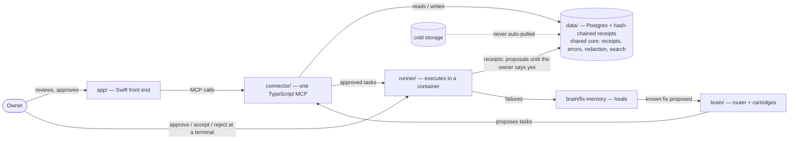

# Architecture

## How the layers talk

- **App → Connector:** the app only ever speaks MCP. It never touches the database directly.
- **Connector → Data:** the Connector is the main way in (exceptions: brain/fix-memory and the runner write their own rows with the AI login, and the owner's approvals use the admin login). Every write, whoever makes it, also appends a receipt whose hash includes the previous receipt's hash, so the log can't be quietly edited.
- **Brain proposes:** the router picks a cartridge and drafts a task. That draft is a *proposal*, stored as data, waiting for approval.
- **Runner executes:** tasks run inside a sealed container with local models only; a passed plan or result waits in `human/` for the owner (`./belt approve` / `accept` / `reject`, typed at a terminal). Each step is receipted in `data/`'s chain (`runner.runner_events`), written directly with the AI's read/write login (as fix-memory does), not through the Connector; a person's yes is written with the admin login and is the only row not marked a proposal.
- **fix-memory heals:** when a run fails, the failure and eventual fix are remembered. Next time the Brain proposes the known fix first.

## Foundation rules

1. AI outputs are proposals.
2. The owner holds agency.
3. Cold storage is never auto-pulled.
4. One Postgres and one MCP per project.
5. A shared core: receipts, error model, redaction, search.
6. Receipts for every write.
